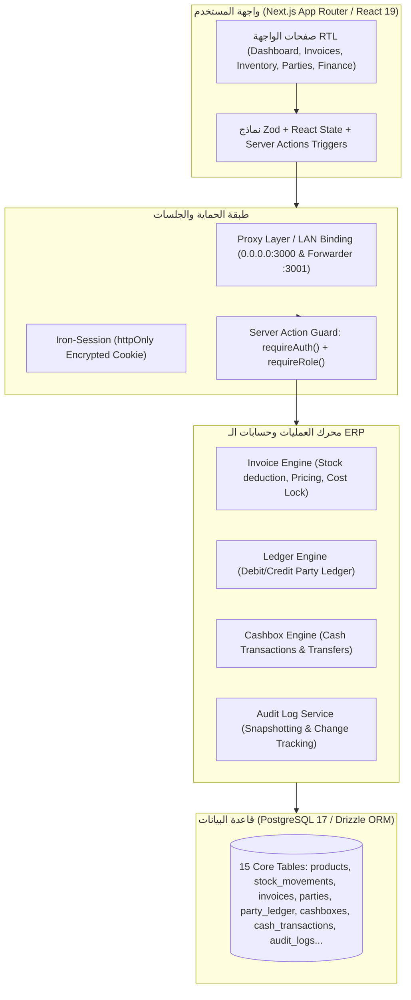
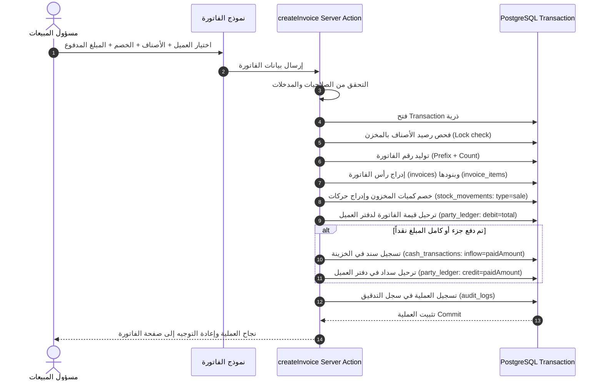

# 01. تقرير فهم النظام والمعمارية الشاملة (System Understanding & Architecture Map)
**مشروع:** لمسة جمال — Cosmetics Supplies Warehouse ERP  
**تاريخ الفحص والتدقيق:** 18 أكتوبر 2026  
**طبيعة البيئة:** PostgreSQL 17 (Docker) + Next.js 16 (Turbopack/App Router) + Drizzle ORM + Tailwind CSS  

---

## 1. نبذة عن النظام وطبيعة العمل (Domain & Business Model)
نظام **لمسة جمال** هو نظام تخطيط موارد مؤسسية (ERP) متخصص في إدارة مستودعات وتجارة توريدات ومستحضرات التجميل بالجملة والتجزئة. يخدم النظام سيناريوهات العمل اليومية للمخزن والمعارض:
1. **المخزون (Inventory Management):** إدارة الأصناف، الباركود والـ SKU، التكلفة، أسعار البيع (جملة/قطاعي/أقل سعر بيع)، تتبع حركات المخزون بجدول حركات زمني، وإدارة التصنيفات.
2. **العملاء والموردين (Parties / Stakeholders):** إدارة أطراف المعاملات (زبائن صالونات، تجار تجزئة، موردين شركات مستحضرات)، وأرصدتهم الافتتاحية ودفاتر حساباتهم المزدوجة (Party Ledger).
3. **المبيعات والمشتريات (Invoicing Engine):** فواتير بيع، فواتير شراء، مردودات بيع وشراء (معرفة في البنية التحتية)، حسابات الخصومات، والمدفوع والآجل، وحركات الصناديق الفورية.
4. **الخزائن والمالية (Cashboxes & Financial Movements):** إدارة الصناديق النقدية (الرئيسية، المعرض، بنك/محفظة)، تحويلات السيولة بين الخزائن، وسندات القبض والصرف والمصروفات التشغيلية.
5. **التقارير وسجل النشاط (Auditing & Analytics):** كشوفات الحسابات للأطراف، موازين المراجعة، وتقارير أرباح الفواتير، وسجل تدقيق شامل (Audit Logs) وتتبع أرقام الفواتير والتعديلات.
6. **الصلاحيات والمستخدمين (RBAC & Auth):** إدارة المستخدمين، أدوار النظام (Super Admin, Admin, Accountant, Sales, Warehouse)، ومطابقة الجلسات بـ Iron Session عبر الكوكيز المشفرة.

---

## 2. معمارية البرمجيات ومكونات النظام (Architecture Blueprint)

---

## 3. خريطة الجداول والعلاقات وقواعد البيانات (Schema Topology)
يحتوي النظام على **15 جدولاً أساسياً** مكتوبة بـ Drizzle ORM داخل ملف [`src/server/db/schema.ts`](file:///Users/mahmoudnagy/Downloads/project-clean/Cosmetics-ERP-SourceCode/src/server/db/schema.ts):

| الجدول | الدور الوظيفي | القيود والروابط الأساسية |
| :--- | :--- | :--- |
| `users` | حسابات الموظفين ومسؤولي النظام | مرن مع `roleId`، وكلمات مرور مشفرة بـ Scrypt |
| `roles` | أدوار وصلاحيات النظام | يحتوي حقل `isSystem` للأدوار غير القابلة للحذف |
| `categories` | تصنيفات مستحضرات التجميل | اسم فريد `unique` |
| `products` | بطاقات الأصناف والأسعار | `sku` فريد، `barcode`، `minSalePrice`، `costPrice`، وعمود الحذف المرن `deletedAt` |
| `stock_movements` | دفتر أستاذ حركة المخزون | يسجل كل زيادة/نقص: `purchase`، `sale`، `initial`، `adjustment`، مع مرجع الفاتورة |
| `parties` | العملاء والموردين | نوع الطرف (`customer` / `supplier`)، الحد الائتماني `creditLimit` |
| `party_ledger` | دفتر أستاذ حسابات العملاء والموردين | حركات `debit` و `credit`، نوع الحركة وربط بالفواتير وسندات القبض/الصرف |
| `cashboxes` | الخزائن النقدية والبنوك | اسم الخزينة، `isDefault`، الرصيد الافتتاحي `openingBalance` |
| `cash_transactions` | حركات السيولة النقدية والمصروفات | `inflow` / `outflow`، مربوطة بفاتورة أو طرف أو كحركة مستقلة (مصروف/إيداع) |
| `cash_transfers` | التحويلات النقدية بين الصناديق | من خزينة إلى أخرى مع المبلغ وتاريخ العملية والمستخدم المسؤول |
| `invoices` | رأس فواتير المبيعات والمشتريات | نوع الفاتورة، الرقم (`unique` لكل نوع)، الإجمالي، الخصم، المدفوع، الآجل، وحالة الدفع |
| `invoice_items` | سطور وبنود الفاتورة | الصنف، الكمية، سعر الوحدة، تكلفة الوحدة وقت الفاتورة `costPrice` لحساب الأرباح بدقة |
| `party_payments` | مدفوعات وسندات الأطراف | دفعات نقدية للعملاء والموردين، تخلق تلقائياً سطراً في `party_ledger` و `cash_transactions` |
| `audit_logs` | السجل الرقابي الموحد للعمليات | يسجل المستخدم، الحدث، الكيان، والبيانات السابقة والجديدة بتنسيق `jsonb` |
| `app_settings` | إعدادات النظام وميتا المستودع | اسم الشركة، اللوجو، الرقم الضريبي، والعملة الافتراضية |

---

## 4. تدفق العمليات الحيوية (Core Business Workflows)

### دورة فاتورة المبيعات (Sale Invoice Cycle)

### دورة فاتورة المشتريات وتحديث التكلفة (Purchase Invoice Cycle)
1. **الطرف المستهدف:** يجب أن يكون من نوع `supplier`.
2. **المخزون:** تزيد أرصدة الأصناف المدخلة فورياً، وتسجل الحركة في `stock_movements` بنوع `purchase`.
3. **تحديث التكلفة:** يقوم النظام بتحديث سعر التكلفة `costPrice` للصنف في جدول `products` ليساوي سعر الشراء في الفاتورة الأخيرة.
4. **الحساب المالي:** تُسجل قيمة الفاتورة كـ `credit` (دائن للمورد) في `party_ledger`. وفي حال السداد، يُسجل المبلغ المسدد كـ `debit` (مدين/سداد) ويُخصم من الخزينة المحددة كـ `outflow`.

---

## 5. الخلاصة المعمارية
المعمارية مبنية على نموذج **Atomic Transactional Consistency**، حيث لا يمكن إنشاء فاتورة أو تعديلها دون تسجيل أثرها الثلاثي المتزامن (مخزون + حساب طرف + حركة خزينة). ومع ذلك، كشف الفحص الدقيق عن نقاط خطر وثغرات حسابية وتصميمية تم توثيقها في سجل العيوب (Defect Register).
