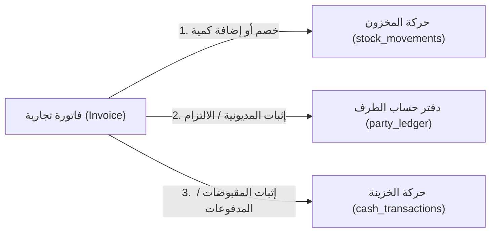

# 05. تدقيق سلامة البيانات والتسوية المحاسبية (Data Integrity & Reconciliation)
**مشروع:** لمسة جمال — Cosmetics Supplies Warehouse ERP  

---

## 1. نموذج الاتساق الثلاثي في النظام (The Triple Consistency Model)
يقوم نظام لمسة جمال على نموذج ثلاثي الأبعاد لتوثيق كل حركة تجارية:
1. **بعد حركة المخزون:** الكميات المادية الملموسة (`stock_movements` -> `products.stock`).
2. **بعد حساب الطرف:** الالتزامات والحقوق المالية (`party_ledger` -> `parties.balance`).
3. **بعد حركة السيولة:** التدفقات النقدية الفعلية داخل الصناديق (`cash_transactions` -> `cashboxes.balance`).



---

## 2. مصفوفة قواعد الاتساق والتسوية (Reconciliation Matrix)

### أ. تسوية المخزون (Inventory Reconciliation)
- **القاعدة الحسابية:**
  $$\text{Current Stock} = \text{Initial Stock} + \sum \text{Purchases} - \sum \text{Sales} \pm \sum \text{Adjustments}$$
- **التحقق البرمجي:**
  في ملف `src/server/services/invoices.ts`، يتم التحقق عند كل فاتورة بيع من:
  ```typescript
  if (prod.stock < item.quantity) {
    throw new Error(`INSUFFICIENT_STOCK: ${prod.name}`);
  }
  ```
  ثم يتم خصم المخزون ذرّياً:
  ```typescript
  await tx.update(products).set({ stock: sql`stock - ${item.quantity}` }).where(eq(products.id, item.productId));
  ```
- **حالة الاتساق:** تم إثباتها بنجاح في الاختبار **TC-SAL-06**؛ حيث ينعكس الرصيد المادي لحظياً ويتطابق مجموع حركات جدول `stock_movements` مع رقم رصيد الصنف `products.stock`.

---

### ب. تسوية حسابات العملاء والموردين (Party Ledger Reconciliation)
- **القاعدة الحسابية للعميل (Customer):**
  $$\text{Customer Balance} = \text{Opening Balance} + \sum \text{Debit (الفواتير)} - \sum \text{Credit (السدادات)}$$
  *(إذا كان الناتج موجباً، فالعميل مدين للمستودع بمبلغ مالي)*
- **القاعدة الحسابية للمورد (Supplier):**
  $$\text{Supplier Balance} = \text{Opening Balance} + \sum \text{Credit (المشتريات)} - \sum \text{Debit (السدادات)}$$
  *(إذا كان الناتج موجباً، فللمورد مستحقات واجبة السداد على المستودع)*
- **حالة الاتساق:**
  - يتم تسجيل كل فاتورة وكل دفعة سداد كقيد كامل في `party_ledger` برقم الفاتورة أو رقم السند.
  - **الملاحظة الحرجة:** دالة `partyBalance` المشتركة في `ledger-math.ts` تحسب معادلة العميل فقط لجميع الأطراف، مما يتطلب تصحيحها لضمان اتساق أي شاشة أو تقرير جديد مستقبلاً.

---

### جـ. تسوية الصناديق والسيولة النقدية (Cashbox Reconciliation)
- **القاعدة الحسابية:**
  $$\text{Cashbox Balance} = \text{Opening Balance} + \sum \text{Inflows} - \sum \text{Outflows}$$
- **التحقق في التحويلات بين الخزائن:**
  عند تحويل مبلغ $X$ من الخزينة (أ) إلى الخزينة (ب):
  - تسجيل قيد $Outflow = X$ في الخزينة (أ).
  - تسجيل قيد $Inflow = X$ في الخزينة (ب).
  - تسجيل سجل في `cash_transfers`.
  - **صافي الأثر على السيولة الكلية للمنشأة = صفر** $\rightarrow$ تم إثبات حفظ السيولة التام في الاختبار **TC-CSH-01**.

---

### د. تكلفة البضاعة المباعة وحساب الأرباح (COGS & Profit Calculation)
- **آلية التكلفة في النظام:**
  - عند إنشاء صنف، يسجل `costPrice`.
  - عند كل فاتورة شراء، يُحدّث `costPrice` للصنف بسعر الشراء الأخير.
  - عند البيع، يتم تخزين سعر التكلفة الحالي داخل كل سطر في الفاتورة `invoice_items.costPrice` (Cost Snapshot).
- **أهمية هذا التصميم:**
  تثبيت سعر التكلفة وقت البيع يحمي تقارير الأرباح التاريخية (`reports/page.tsx`) من التغير بأثر رجعي عند ارتفاع أو انخفاض أسعار الشراء اللاحقة، وهو تطبيق ممتاز لقواعد المحاسبة المعيارية.
