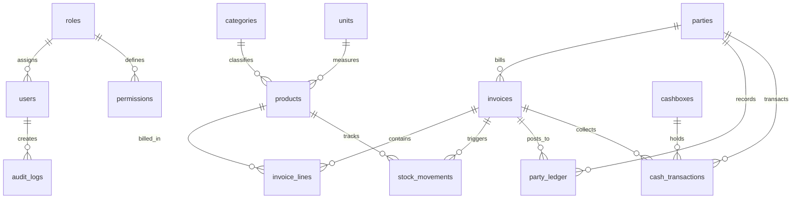
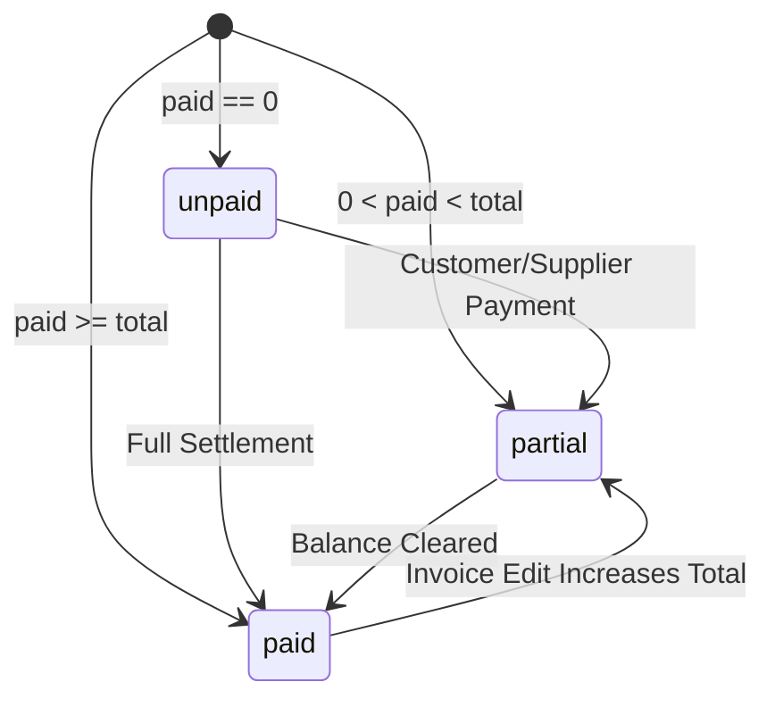

# SYSTEM_UNDERSTANDING.md — Lamsat Gamal ERP Architecture & Domain Specification

**Project:** لمسة جمال (Lamsat Gamal) — Cosmetics Supplies Warehouse ERP  
**Audit Date:** October 18, 2026  
**Auditor Roles:** Senior ERP Business Analyst, Software Architect, Database Integrity Auditor  
**Runtime Environment:** Next.js 16.0.0 (Turbopack/Webpack), React 19.2.0, TypeScript 5.9.3, Drizzle ORM 0.44.5, PostgreSQL 17 on Docker (`cosmetics-db` :55432)

---

## 1. Domain & Business Model Overview

Lamsat Gamal ERP is an on-premises and local-network enterprise resource planning system tailored for a wholesale and retail cosmetics warehouse in Egypt. The core business involves purchasing cosmetics, salon products, and beauty supplies in bulk from manufacturers/importers and selling them to beauty salons, retail shops, and walk-in consumers.

### Key Business Operations
1. **Product & Inventory Management:** Tracking cosmetics with SKUs, barcodes, categories, cost prices, wholesale/retail sale prices, reorder alerts, and chronological stock movements.
2. **Commercial Parties (Customers & Suppliers):** Maintaining contact info, opening balances, and tracking real-time accounts receivable (customers/salons) and accounts payable (suppliers/distributors) via an auditable ledger.
3. **Invoicing Engine:** Processing multi-line sales and purchase invoices, locking cost prices at the moment of sale for gross profit reporting, applying header-level discounts/taxes, and supporting full, partial, or zero cash settlement.
4. **Treasury & Liquidity (Cashboxes):** Managing physical cash drawers (main warehouse, retail counter) and digital wallets/bank accounts, tracking inbound customer receipts, outbound supplier payments, operating expenses, and inter-box cash transfers.
5. **Auditing & Reporting:** Comprehensive party statements, category performance reports, top-selling products, and daily dashboard KPI aggregations.
6. **Authentication & Role-Based Access Control (RBAC):** Session-based login with Argon2/Scrypt hashing, HMAC-SHA256 encrypted cookies, and fine-grained per-module permissions.

---

## 2. Verified Technology Stack & Infrastructure

All versions verified directly from [`package.json`](file:///Users/mahmoudnagy/Downloads/project-clean/Cosmetics-ERP-SourceCode/package.json) and lockfile:

| Layer | Component | Version | Evidence / Source File |
| :--- | :--- | :--- | :--- |
| **Framework** | Next.js App Router | `16.0.0` | [`package.json`](file:///Users/mahmoudnagy/Downloads/project-clean/Cosmetics-ERP-SourceCode/package.json#L24) |
| **UI Library** | React & React DOM | `19.2.0` | [`package.json`](file:///Users/mahmoudnagy/Downloads/project-clean/Cosmetics-ERP-SourceCode/package.json#L26-L27) |
| **Language** | TypeScript | `5.9.3` | [`package.json`](file:///Users/mahmoudnagy/Downloads/project-clean/Cosmetics-ERP-SourceCode/package.json#L40) |
| **Database** | PostgreSQL | `17` | Docker Container `cosmetics-db` (Port `55432`) |
| **ORM & Migrations**| Drizzle ORM & Kit | `0.44.5` / `0.31.5` | [`package.json`](file:///Users/mahmoudnagy/Downloads/project-clean/Cosmetics-ERP-SourceCode/package.json#L21) |
| **Database Driver** | `node-postgres` (`pg`) | `8.16.3` | [`package.json`](file:///Users/mahmoudnagy/Downloads/project-clean/Cosmetics-ERP-SourceCode/package.json#L25) |
| **Validation** | Zod | `4.1.11` | [`package.json`](file:///Users/mahmoudnagy/Downloads/project-clean/Cosmetics-ERP-SourceCode/package.json#L29) |
| **Password Hashing**| Argon2 & node:crypto | `0.44.0` | [`package.json`](file:///Users/mahmoudnagy/Downloads/project-clean/Cosmetics-ERP-SourceCode/package.json#L19) |
| **Session Security**| HMAC-SHA256 Signed Cookies | Native node:crypto | [`src/server/auth/session.ts`](file:///Users/mahmoudnagy/Downloads/project-clean/Cosmetics-ERP-SourceCode/src/server/auth/session.ts) |
| **Styling** | Tailwind CSS V4 | `4.1.14` | [`package.json`](file:///Users/mahmoudnagy/Downloads/project-clean/Cosmetics-ERP-SourceCode/package.json#L38) |
| **Test Runner** | Vitest | `3.2.4` | [`vitest.config.ts`](file:///Users/mahmoudnagy/Downloads/project-clean/Cosmetics-ERP-SourceCode/vitest.config.ts) |

---

## 3. Database Schema & Entity Relationships

The system defines **15 tables** inside [`src/server/db/schema.ts`](file:///Users/mahmoudnagy/Downloads/project-clean/Cosmetics-ERP-SourceCode/src/server/db/schema.ts):

### Table Definitions & Key Constraints

1. **`users`:** Staff and admin accounts. Unique constraint on `username`. Has foreign key `roleId` referencing `roles.id`. Soft-delete column `deletedAt` exists in schema, but code uses `active: boolean` toggle.
2. **`roles`:** Security roles (`isSystem: boolean` prevents accidental deletion of core roles).
3. **`permissions`:** Relates `roleId` to `module` (`inventory`, `invoices`, `finance`, `parties`, `users`, `settings`, `reports`) and `action` (`view`, `create`, `edit`, `delete`, `export`). Unique composite constraint `role_permission_uq(roleId, module, action)`.
4. **`audit_logs`:** Central audit trail recording `userId`, `action`, `entity`, `entityId`, and `details` (`jsonb`). Indexed on `createdAt`.
5. **`settings`:** Organization identity (name, logo, currency, tax rate, invoice footer). Single-row table with `id = 1`.
6. **`categories`:** Hierarchical product classifications (`parentId` self-reference). Includes `deletedAt`.
7. **`units`:** Measurement units (e.g., قطعة, باكت, كرتونة) with conversion factor.
8. **`products`:** Core SKU catalog. Unique constraint `product_sku_uq(sku)`. Tracks `costPrice`, `salePrice`, `stock`, `reorderLevel`, `active`, and `deletedAt`. Indexed on `name` and compound `(stock, reorderLevel)`.
9. **`parties`:** Customers and suppliers (`type`: `customer` | `supplier`). Tracks contact info, address, `openingBalance`, and `deletedAt`. Indexed on `(type, name)`.
10. **`cashboxes`:** Financial repositories (`kind`: `cash` | `bank` | `wallet`). Tracks `openingBalance` and `active`.
11. **`invoices`:** Commercial transaction headers (`type`: `sale` | `purchase` | `sale_return` | `purchase_return`). Unique constraint `invoice_type_number_uq(type, number)`. Stores `subtotal`, `discount`, `tax`, `total`, `paid`, and `status`.
12. **`invoice_lines`:** Items within each invoice. Captures `productId`, `quantity`, `unitPrice`, snapshot of `costPrice` at transaction time, and calculated `lineTotal`. Cascades on invoice deletion.
13. **`stock_movements`:** Inventory audit ledger. Records movement `type` (`purchase`, `sale`, `sale_return`, `purchase_return`, `adjustment`), signed delta, `quantity`, `unitCost`, and optional `invoiceId` / `reason`.
14. **`cash_transactions`:** Real cash flow records (`kind`: `income`, `expense`, `transfer_in`, `transfer_out`, `invoice_payment`, `party_payment`). Linked to `cashboxId`, `invoiceId`, `partyId`, or `transferId`.
15. **`party_ledger`:** Double-entry customer/supplier statement ledger. Captures `debit` and `credit` columns per party, linking to `invoiceId`.

---

## 4. Transaction Boundaries & Concurrency

### A. Invoice Creation (`createInvoice` in [`src/server/services/invoices.ts`](file:///Users/mahmoudnagy/Downloads/project-clean/Cosmetics-ERP-SourceCode/src/server/services/invoices.ts))
All mutations occur within a single atomic PostgreSQL transaction `db.transaction(async tx => ...)`:
1. Validates all line items, non-zero quantities, and active products.
2. Checks stock availability (`prod.stock >= quantity`) for all sale items simultaneously.
3. Acquires PostgreSQL advisory transaction lock: `select pg_advisory_xact_lock(hashtext(${input.type}))` to serialize concurrent invoice number generation.
4. Generates invoice number prefix (`SAL-` or `PUR-`) + sequence.
5. Inserts `invoices` header.
6. For each item:
   - Inserts `invoice_lines` with unit cost snapshot.
   - Atomically mutates product inventory via SQL: `stock = stock + delta`.
   - Inserts row in `stock_movements`.
7. If `partyId` is supplied:
   - Posts total invoice amount to `party_ledger` (Debit for sale, Credit for purchase).
   - If `paid > 0`, posts immediate payment credit/debit to `party_ledger`.
8. If `paid > 0` and `cashboxId` is supplied:
   - Posts `cash_transactions` record (`invoice_payment` for sale, `expense` for purchase).

### B. Invoice Editing (`updateInvoice` in [`src/server/services/invoices.ts`](file:///Users/mahmoudnagy/Downloads/project-clean/Cosmetics-ERP-SourceCode/src/server/services/invoices.ts))
1. Locks invoice row using `for("update")`.
2. Locks and fetches old product lines using `for("update")`.
3. Restores previously deducted or added stock via `restoreEditedInvoiceStock`.
4. Writes compensating `stock_movements` rows with reason `تعديل الفاتورة`.
5. Writes reversing `cash_transactions` and reversing `party_ledger` records (swapping debit and credit) to maintain an unbroken audit trail without deleting history.
6. Re-applies new items, new stock movements, new ledger lines, and new cash transactions.

---

## 5. State Machines & Status Lifecycles

### Invoice Payment Status Lifecycle

### Entity Deletion Lifecycles
- **Products:** Soft-deleted via `deletedAt = new Date()`, `active = false`. Never deleted with SQL `DELETE` to prevent orphan references in historical invoices.
- **Parties:** Soft-deleted via `deletedAt = new Date()`. Historical ledger lines preserved.
- **Categories:** Soft-deleted via `deletedAt = new Date()`.
- **Users:** Soft toggle via `active = !active`. No permanent deletion.
- **Invoices:** No UI delete action exists. Invoices can only be edited, creating compensating ledger entries.
